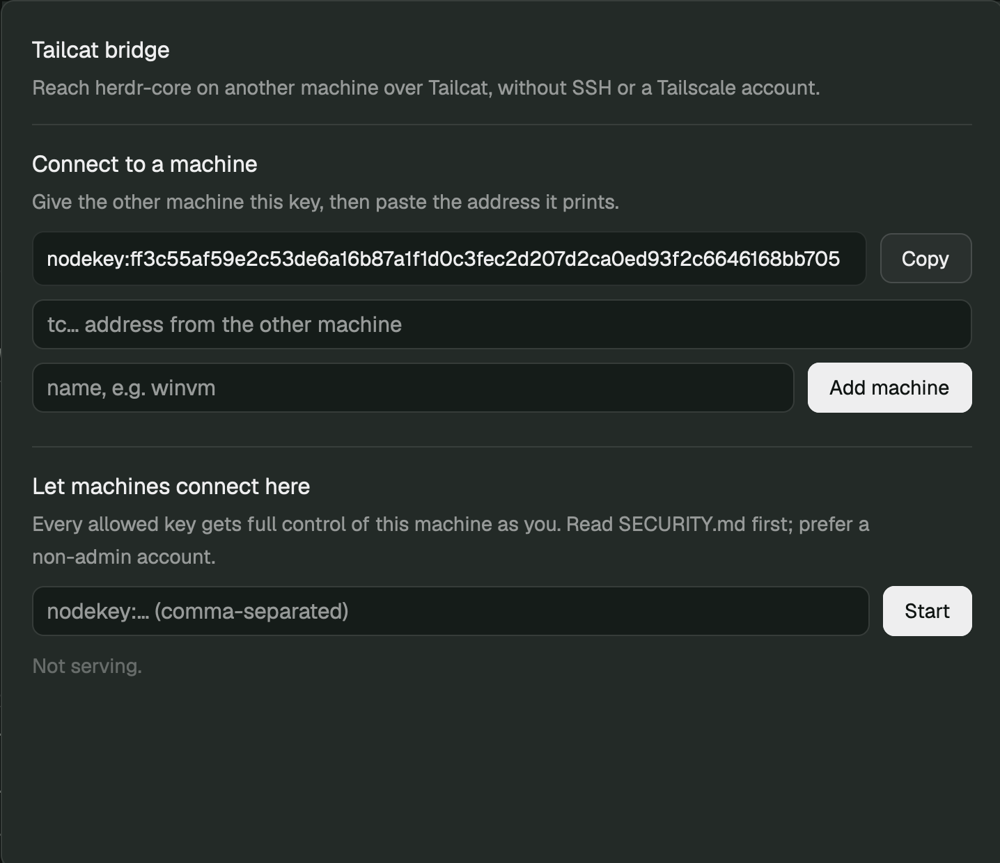

# herdr-tsbridge

Lets Herdr (`hc`) reach herdr-core on another machine, such as a Windows VM, over [Tailcat](https://github.com/tailscale/tailcat) instead of SSH. You don't need SSH, open ports, or a Tailscale account. Read [SECURITY.md](SECURITY.md) before serving.



## Install the Herdr mod

Give your agent this prompt, on each machine:

```
Read ~/.config/herdr-app/AGENTS.md, then add this mod: https://github.com/dhruvsaxena1998/herdr-tsbridge
```

Then open it with `herdr-app do mod.open --name tsbridge`. On first open, it downloads the pinned, hash-checked binary.

## Use

1. **Client** (for example, your Mac): copy the `nodekey:` that **Connect to a machine** shows.
2. **Server** (for example, the Windows VM): paste that key into **Let machines connect here**, press **Start**, and copy the `tc…` address it shows.
3. **Client**: paste the address, give the machine a name, and press **Add machine**.

## CLI

```
herdr-tsbridge key                                     print this machine's client nodekey
herdr-tsbridge addr                                    print the saved server address (secret)
herdr-tsbridge serve -allow nodekey:...[,...] [-herdr PATH] [-log FILE] [-max-conns N]
herdr-tsbridge pipe ADDRESS                            stdin/stdout to the server (hc --via)
```

Build: `CGO_ENABLED=0 GOOS=… GOARCH=… go build -trimpath -ldflags '-s -w'`.
