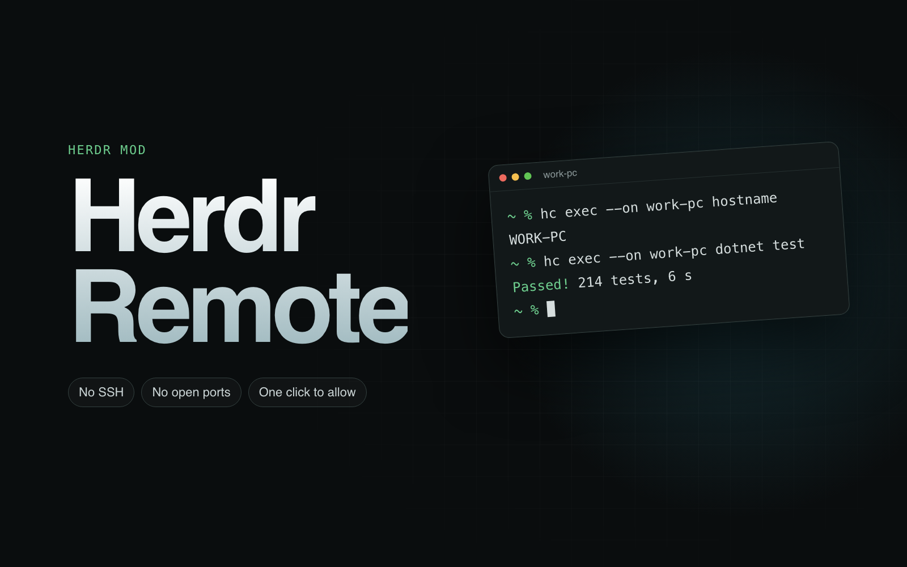

# Herdr Remote

A dialog that connects Herdr to herdr-core on another computer (a Windows VM, another laptop) over Tailcat, Tailscale's data plane with no account, instead of SSH. The same dialog runs on both computers. Pairing takes one string: the sharing computer's invite code, pasted on the other one, which then asks to connect; the sharing computer approves it by a short pairing code.

## What you see

A 600×560 dialog on `popover`, 18px padding, 13px text, scrolling when taller. A header row: **Herdr Remote** (15px semibold) and a `dim` **Esc** chip that closes it (so does the Escape key). Under it, a 12px `muted` line: "Use your other computers' terminals right here. No SSH or VPN needed."

**Until the helper is in place**, one card on `background` titled **One-time setup** says what `herdr-remote v0.3.0` is and where it goes, with **Download**. If an older or different binary is there, the card is **An update is needed** with **Update**. While downloading, a spinning `working` icon and "Downloading…" replace the button.

**After that, one page with two parts:**

1. **Your computers** (13.5px semibold) with an **Add a computer** button (primary) on the right.
   - One row per computer added through this bridge: a server icon, its name, a status (`done` dot "Online", `blocked` dot "Offline" with a `dim` line under it, "Can't reach it. Is Share this computer turned on over there?", or the raw state), and **Remove**. The first click turns it into a `blocked` "Remove?" for 4 seconds; a second click removes it.
   - With none: "None yet. Add one to use its terminals from here."
   - **Add a computer** opens a card with three numbered steps (20px circles on `raised`): 1. "On the other computer, open Herdr Remote and turn on Share this computer." 2. "Copy the invite code it shows, and paste it here:" with a field. 3. "Name this computer:" with a field (Enter connects). Then **Cancel** and **Connect**.
   - While waiting: a card with an `accent` border, a spinner and "Waiting for the other computer to allow <name>…", this computer's pairing code in 22px semibold on `raised` (like `0K4-58W`), "On the other computer, click Allow next to this code." and **Cancel**.

2. **Share this computer**, below a 1px `border` line: a switch (34×20, `solid` when on) with the title and a `muted` line: "Let your other computers use this one's terminals." / "On. Computers you allow can use this one." / "Turning on…".
   - When on: a warning strip tinted `blocked` (`14` fill, `40` border): "Computers you allow can do anything you can do on this computer." and an `accent` **Security notes** link to SECURITY.md on GitHub.
   - Step 1: "Copy this invite code and paste it on the computer that will connect. Keep it private, like a password.", with the `tc…` code (truncated) and **Copy**.
   - Step 2: "When it asks to connect, check the code matches and click Allow." Each request is a card with an `accent` border: "A computer wants to connect", "Allow it only if the other computer shows this code.", the pairing code (16px semibold on `raised`), and below them **Don't allow** and **Allow** (primary). With none: "Waiting for a computer to ask. Keep this window open so you can allow it."
   - If sharing ends without being turned off: "Sharing stopped on its own. The last thing it printed:" and its last 3 lines.
   - **Computers allowed to connect here** (whenever any exist, sharing or not): a row per approved computer with a monitor icon, its pairing code, "allowed Nov 26", and **Remove** (two clicks, as above).

A `dim` 11.5px footer: "Open this again with <key>, or "Herdr Remote" in the command palette." (the key from `keys()`: the `cmd-` one on macOS, the other elsewhere; without one, only the palette).

Buttons are 30px tall with radius 7: primary `solid`, others `raised` with an `input` border. While an action runs, its button reads "Working…" and every button is dimmed and ignores clicks. **Copy** reads "Copied" for 1.5s. Results show in 12px under each part: errors in `blocked`, success in `done`.

## How it behaves

- **Finding the helper.** On open it finds the platform (a home path like `C:\…` means Windows) and the architecture (`uname -sm`, or `%PROCESSOR_ARCHITECTURE%`), then hashes `~/.local/bin/herdr-remote` or `%LocalAppData%\herdr-remote\herdr-remote.exe`. It uses the binary only when the SHA-256 matches the table pinned in `main.js`.
- **Download** runs `curl -fsSL --create-dirs` from this repo's GitHub release into `<bin>.download`, checks the hash, and only then does `chmod 755` and moves it over `<bin>` (`move /y` on Windows). A mismatch deletes the temp file, so an unverified binary never lands on PATH. On Windows the move fails while the old `.exe` is running (serve or a pipe); the temp file is deleted and the error says to stop those first.
- **Connect** checks the invite code (`tc` plus base64url characters), the name (lowercased, `[a-z0-9-]{1,32}`) and that the name isn't already listed. It shows `<bin> code`, then runs `<bin> wait <invite>`, which pings the server about once a second, for up to 5 minutes, until it's admitted. Then it runs `hc machine add --via '<bin> pipe <invite>' --name <name> --json`. On Windows the binary path is double-quoted, because `--via` is split with CommandLineToArgvW there. On Unix it is a single-quoted sh line. A timeout shows "The other computer didn't allow it in time…". Cancel stops listening; the `wait` process runs out its time.
- **Your computers** is `hc machine ls --json`, keeping non-temporary machines whose `target` contains `herdr-remote` and ` pipe `. **Remove** runs `hc machine rm <name>`.
- **On open** it runs `hc kill tsbridge-serve` and `hc rm tsbridge-serve`, ignoring failures: sharing started by the old Tailcat bridge dialog would otherwise keep running unseen.
- **Turning sharing on** first moves keys typed into the old dialog (`localStorage` "allow") into the approved list with `<bin> allow`. It removes a finished `remote-serve` terminal, then runs `hc run --bg --no-parent --name remote-serve -- <bin> serve -log <audit log>`. The server is a herdr-core terminal, so it keeps running when the window closes. The audit log goes to `%LocalAppData%\herdr-remote\audit.log` or `~/.local/state/herdr-remote-audit.log`. Turning it off runs `hc kill remote-serve`.
- **Requests.** An unapproved computer that pings becomes a request in `<bin> clients` (JSON: `pending` and `allow`, each `{key, code, since}`). **Allow** runs `<bin> allow <key>`, **Don't allow** `<bin> deny <key>`, and **Remove** under allowed computers `<bin> revoke <key>`. The running serve applies each within a second; revoking also closes that computer's sessions.
- Every 2 seconds (skipped while the last refresh is still running) it reads `hc get remote-serve --json`, `hc machine ls --json` and `<bin> clients`. While the server is live and the invite isn't known yet, it runs `<bin> addr`, which prints the saved address. It never parses the terminal screen, where a long address would wrap.

## Built from

One mod, `mods/remote/`: `main.js` and `mod.json` (`place: "none"`, title "Herdr Remote", a 600×560 dialog overlay, and a `palette` entry that runs `mod.open {name: "remote"}`). A `keys.json` at the repo root binds `cmd-alt-t` (macOS) and `ctrl-shift-y` (Windows/Linux; ctrl-alt is AltGr there) to `mod.open:remote`; merge it into the person's. The footer shows the `cmd-` key on macOS and the other one elsewhere. It also opens with `herdr-app do mod.open --name remote`.

It uses `div`, `svg`, `h_flex`, `v_flex`, `InputState`/`Input`, `cx.write_to_clipboard`, `cx.open_url` and `cx.timer`, and the shipped `mods/workspace-chrome/{spinner,server}.svg` icons. From `herdr` it uses `exec`, `hc`, `home`, `theme`, `checking`, `keys`, `props` and `closeOverlay`.

**Programs it runs:** `herdr-remote` (`code`, `wait`, `clients`, `allow`, `deny`, `revoke`, `addr`, `serve`), `hc`, `curl`, `uname`/`cmd`, `sha256sum`/`shasum`/`certutil`, `chmod`, `mv`/`move`, `rm`/`del`, `mkdir`.

**Network:** the one-time download from `github.com/dhruvsaxena1998/herdr-remote/releases`. After that, the binary itself reaches Tailscale's DERP relays and `tailcat.dev` (first serve only).

**Files outside its folder:** it writes the binary path and the audit log above. The binary keeps the approved and pending lists (`<profile>-clients.json`, `<profile>-pending.json`, public keys only) next to its secrets. The binary keeps its secrets in the macOS Keychain, or encrypted with DPAPI under `%LocalAppData%` (see SECURITY.md).

The Go source for the binary is at the root of this repo. Build it with `CGO_ENABLED=0 go build -trimpath -buildvcs=false -ldflags '-s -w'` per GOOS/GOARCH. Publishing a new release means updating `VERSION` and `SHA256` in `main.js`.

## Watch out

- `window()` is null during `herdr-app check`, so platform detection uses `home()`.
- `.child(null)` throws, so an empty note is an empty `div()`.
- `herdr-app check` draws only the "Checking…" state, so try the add, waiting and sharing states in the app too. Its `init` skips every `exec` while `checking()`.
- `toLocaleDateString` options are ignored in Herdr's JS, so the "allowed" date is formatted by hand.
- `hc machine add` refuses a machine that is this same core ("is this core"), so a loopback test proves the tunnel but can't add it.
- Approving gives that computer a full `herdr-core connect` as the current user. Requests are decided before the WireGuard handshake, so the pairing-code check is what tells a person it's their own computer; the invite's pre-shared key is what keeps strangers out.
- The sharing computer sees only a pairing code for each client, not its name.
- Builds exist for darwin, windows and linux, amd64 and arm64, and are reproducible. Linux keeps secrets in 0600 files.

## Done when

- `herdr-app check mods/remote` passes.
- On a fresh machine, **Download** fetches the helper and the page shows **Your computers** and **Share this computer**.
- `cmd-alt-t` (macOS) / `ctrl-shift-y` (Windows) and the palette's **Herdr Remote** open it; Escape closes it.
- On the sharing computer, turning on **Share this computer** shows a `tc…` invite code.
- On the other computer, pasting it with a name and clicking **Connect** shows a pairing code, and the same code appears as a request on the sharing computer.
- **Allow** there makes the other computer list it under **Your computers** and in `hc machine ls`, and `hc exec --on <name> hostname` prints the sharing computer's hostname.
- **Remove** under **Computers allowed to connect here** disconnects it within seconds, and it shows Offline on the other computer.
- Turning sharing off ends serve, and the other computer can no longer reach it.
